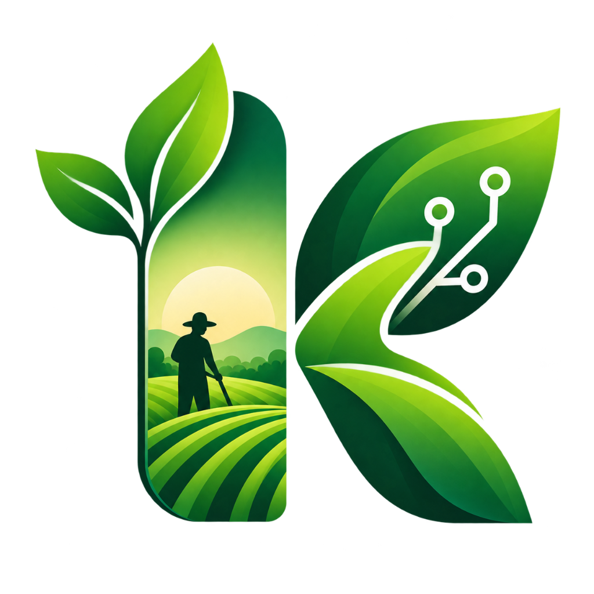

<div align="center">



#  K-Mart AI

### Empowering Farmers. Connecting Consumers. Driven by Intelligence.

<br/>


<br/>

**An AI-powered Direct Farm-to-Consumer Marketplace that helps farmers sell smarter and consumers buy smarter.**

<br/>

[Features](#-features) •
[Technology Stack](#-technology-stack) •
[Architecture](#-architecture) •
[Getting Started](#-getting-started) •
[Future Scope](#-future-scope)

</div>

---

# 🚜 About K-Mart AI

**K-Mart AI** is a next-generation agricultural marketplace designed to directly connect farmers with consumers, reducing dependency on middlemen and bringing greater transparency to agricultural trade.

Unlike a traditional agricultural marketplace, K-Mart AI integrates an intelligent AI-powered decision-support system that helps both farmers and consumers make smarter decisions.

### For Farmers

> Know **when to sell, where to sell, and at what price to sell.**

### For Consumers

> Know **what to buy, when to buy, and whether the current price is worth it.**

K-Mart AI combines a modern digital marketplace with Artificial Intelligence to create a smarter agricultural commerce ecosystem.

---

# 💡 Problem Statement

The agricultural ecosystem continues to face several major challenges:

- Farmers often depend heavily on intermediaries and middlemen.
- Farmers may not receive fair market prices for their produce.
- Consumers often pay significantly higher prices.
- There is limited transparency between farmers and end consumers.
- Farmers lack access to data-driven selling insights.
- Consumers have limited information about price trends and product value.
- Agricultural decisions are often made without proper market intelligence.
- Small farmers have limited access to large digital marketplaces.

These problems create a disconnect between the people who grow food and the people who consume it.

---

#  Our Solution

K-Mart AI creates a direct digital bridge between farmers and consumers.

```text
        FARMERS
           │
           │
           ▼
    ┌───────────────┐
    │   K-MART AI   │
    │               │
    │ Marketplace + │
    │ AI Intelligence│
    └───────────────┘
           │
           │
           ▼
       CONSUMERS